# Stable Lords — Player's Manual

> _Build a stable. Train warriors. Fight for glory. Forge legends in the arena._
> Version 3.0.0

---

## Table of Contents

1. [Introduction](#1-introduction)
2. [Getting Started](#2-getting-started)
3. [Your First Stable — The Guided Start](#3-your-first-stable--the-guided-start)
4. [The Weekly Loop](#4-the-weekly-loop)
5. [Finding Your Way Around](#5-finding-your-way-around)
6. [Warriors](#6-warriors)
   - 6.1 [Attributes](#61-attributes)
   - 6.2 [Combat Skills](#62-combat-skills)
   - 6.3 [Fighting Styles](#63-fighting-styles)
   - 6.4 [Traits & Assessments](#64-traits--assessments)
   - 6.5 [What the Game Keeps Hidden](#65-what-the-game-keeps-hidden)
7. [Recruitment & Free Agents](#7-recruitment--free-agents)
8. [Training & Trainers](#8-training--trainers)
9. [Equipment](#9-equipment)
10. [Fight Plans](#10-fight-plans)
11. [Combat — How Bouts Resolve](#11-combat--how-bouts-resolve)
12. [Injuries, Aging & Death](#12-injuries-aging--death)
13. [Booking Fights](#13-booking-fights)
14. [The Treasury](#14-the-treasury)
15. [The Arena Circuit](#15-the-arena-circuit)
16. [Tournaments & the Grand Championship](#16-tournaments--the-grand-championship)
17. [The Living World](#17-the-living-world)
18. [Scouting](#18-scouting)
19. [News, Memory & Legends](#19-news-memory--legends)
20. [The Offseason](#20-the-offseason)
21. [Objectives & Victory](#21-objectives--victory)
22. [Saves, Mods & Tools](#22-saves-mods--tools)
23. [A Manager's Playbook](#23-a-managers-playbook)
24. [Glossary](#24-glossary)
25. [Troubleshooting](#25-troubleshooting)

---

## 1. Introduction

**Stable Lords** is a tactical management game set in a brutal arena world. You are the owner of a fighting _stable_ — a roster of warriors you recruit, train, equip, and send onto the sands to earn fame and fortune.

The game is inspired by **Duelmasters**, the classic play-by-mail strategy game, and builds on its canonical attribute, skill, and fighting-style systems — then surrounds them with a living world: dozens of AI-run rival stables, a weekly news cycle, wandering promoters, shifting style metas, and a season that ends in glory or grief.

**This is not a twitch game.** Nothing in combat depends on your reflexes. You plan, prepare, and commit — then watch your warriors fight according to their training and your instructions.

Success requires:

- Picking warriors with the right attributes for their fighting style
- Writing fight plans that match both the warrior and the opponent
- Matching warriors to the right fights at the right price
- Keeping the treasury solvent through injuries, deaths, and lean weeks
- Knowing when a warrior's career should end — before the arena ends it

---

## 2. Getting Started

### Running the Game

```bash
# Install dependencies (first time only)
bun install

# Start the web version
bun run dev
# Open http://localhost:8080 in your browser

# OR start the desktop (Electron) version
bun run electron:dev
```

### The Title Screen

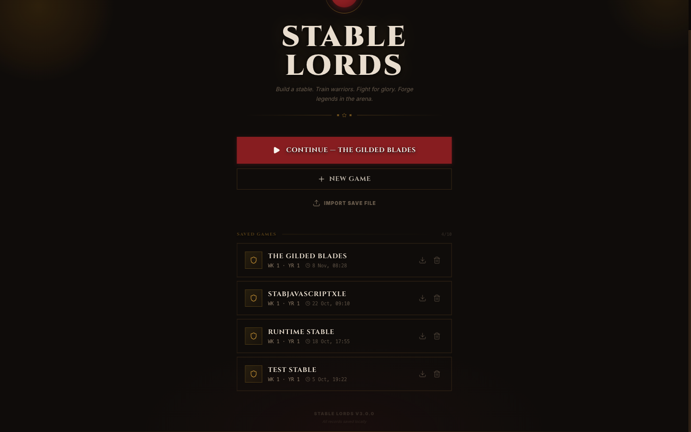

From the title screen you can:

- **Continue** — jump straight into your most recent save
- **New Game** — found a new stable (see §3)
- **Import Save File** — load an exported save pack (see §22)
- **Saved Games** — up to **10 save slots**; each can be loaded, exported, or deleted individually

All saves live locally — in your browser's storage for the web version, and in the app data folder for the desktop version. The game **autosaves after every weekly simulation**, so you never need to save manually.

---

## 3. Your First Stable — The Guided Start

Founding a stable walks you through five steps:

### Step 1 — Identity

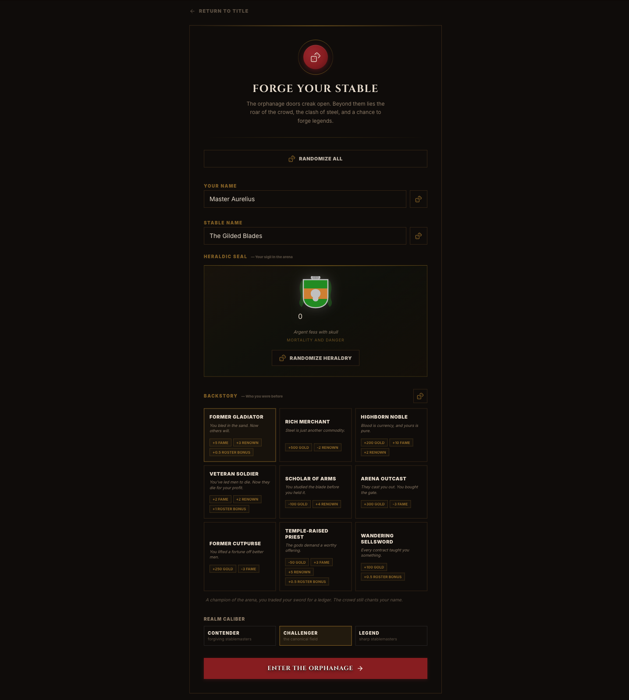

Name your **owner** and your **stable**, design a **heraldic crest**, pick a **backstory**, and choose a **realm caliber** (difficulty).

Your backstory is not just flavor — each of the nine backgrounds grants real starting modifiers:

| Backstory | Starting modifiers |
| --- | --- |
| Former Gladiator | +5 Fame, +3 Renown, +0.5 Roster Bonus (and −100g) |
| Rich Merchant | +500 Gold, −2 Renown |
| Highborn Noble | +200 Gold, +10 Fame, +2 Renown |
| Veteran Soldier | +2 Fame, +2 Renown, +1 Roster Bonus |
| Scholar of Arms | +4 Renown, −100 Gold |
| Arena Outcast | +300 Gold, −3 Fame |
| Former Cutpurse | +250 Gold, −3 Fame |
| Temple-Raised Priest | +3 Fame, +5 Renown, +0.5 Roster Bonus (−50g) |
| Wandering Sellsword | +100 Gold, +0.5 Roster Bonus |

Several backstories also quietly steer the orphanage toward the owner's favored fighting styles, and adjust how the game models your owner's personality in rival AI's eyes.

> **Which should you pick?** Rich Merchant and Highborn Noble are the gentlest starts (money and fame). Arena Outcast and Former Cutpurse are cheaper warriors but fame-negative. The flavor picks — Gladiator, Veteran, Sellsword — lean on roster quality.

### Step 2 — Choose Warriors

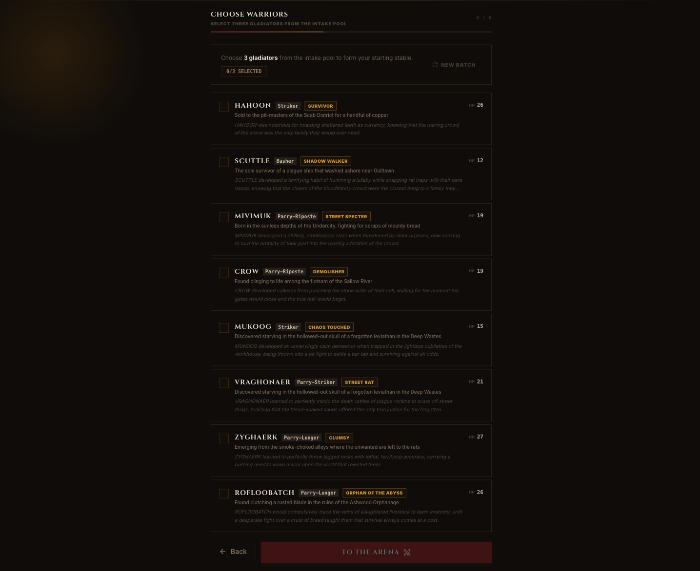

The **orphanage** presents an intake pool of candidate gladiators. You choose **three** to found your roster. Each candidate shows their physique (the attribute radar), their fighting style, and an assessment of how they carry themselves. If none of the batch appeals, **New Batch** rerolls the intake.

This is the single most consequential decision in a new game. See §6 and §23 for how to read a recruit — in short: check that their strongest attributes feed the skills their style rewards, and don't chase raw attribute totals.

### Step 3 — Set the Plan

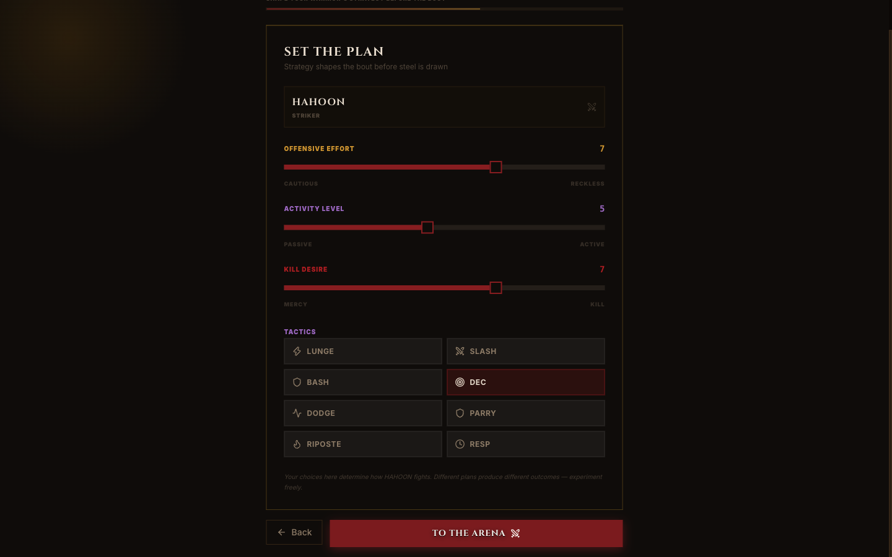

You'll write a first **fight plan** for one of your warriors: sliders for **Offensive Effort (OE)**, **Activity Level (AL)**, and **Kill Desire (KD)**, plus an offensive and defensive tactic. Don't agonize — the defaults are survivable, and you'll rewrite plans constantly. §10 explains the whole system.

### Step 4 — First Blood

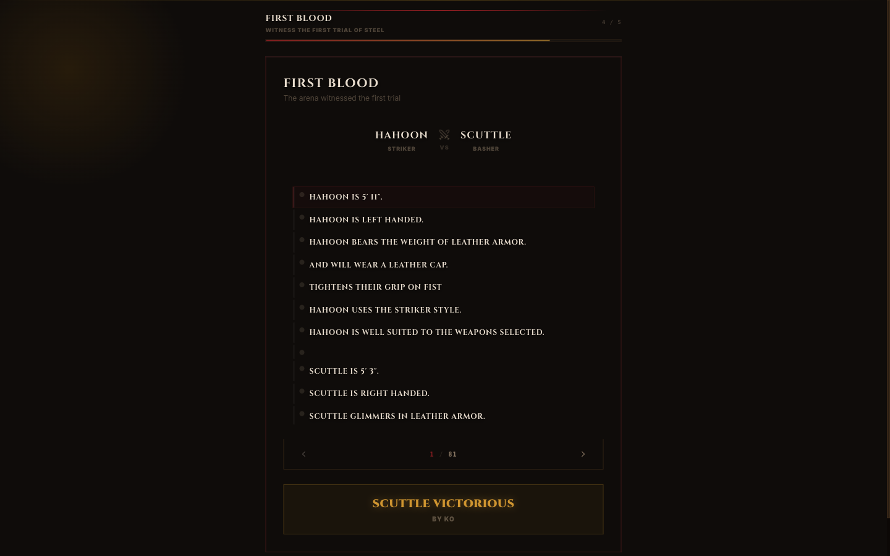

Your chosen warrior fights a **tutorial bout**, narrated exchange by exchange. Read the narration — it's not just flavor. It tells you which exchanges your warrior won, where the fight turned, and (often) hints about the warrior's hidden aptitudes.

### Step 5 — Your Story Begins

The stable overview opens, the world is already moving around you, and the first weekly planning phase begins.

---

## 4. The Weekly Loop

Stable Lords runs in **weekly turns**. Each week has two phases:

```
┌──────────────────────────────────────────────────────┐
│  PLANNING PHASE (you control this)                   │
│   • Review roster, treasury, injuries, feed          │
│   • Assign training to warriors                      │
│   • Equip warriors and set fight plans               │
│   • Accept or decline bout offers                    │
│   • Hire trainers, recruit, scout, petition titles   │
└───────────────────────┬──────────────────────────────┘
                        │
                        ▼  EXECUTE WEEK
┌──────────────────────────────────────────────────────┐
│  SIMULATION PHASE (automated)                        │
│   • Booked bouts are fought — yours and the world's  │
│   • Training results are applied                     │
│   • Economy ticks (income − expenses)                │
│   • Injuries heal, warriors learn, the world churns  │
│   • Gazette + arena feed are published               │
│   • The game autosaves                               │
└──────────────────────────────────────────────────────┘
```

There are **52 weeks per in-game year**, split into four 13-week seasons. At the year boundary the offseason runs: annual awards, aging, retirements, roster churn, and a random world event (§20).

> **Alerts matter.** The alert bar at the bottom of the screen ("2 WARRIORS NEED TRAINING ASSIGNMENT") surfaces the week's pending decisions. Clear it before executing the week.

### Auto-Advance and the War Council

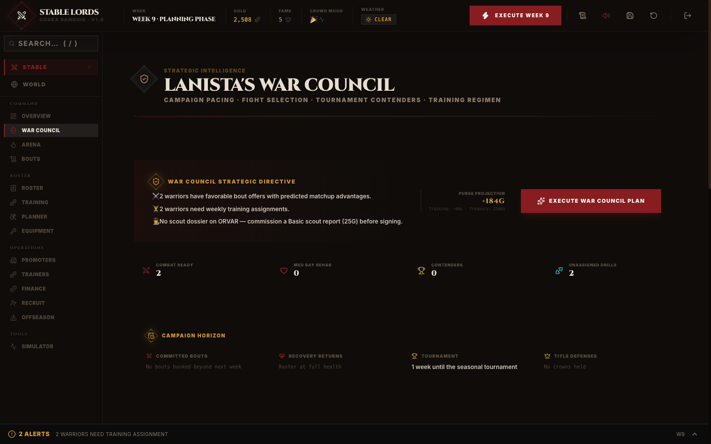

Two helpers exist for hands-off stretches:

- **Auto-Advance** — simulates 4, 8, or 13 weeks at once. It **pauses automatically** if your stable suffers a casualty or something needs your eye.
- **War Council Autopilot** — the advisor scores incoming bout offers and applies training assignments each week on your behalf. Useful for grinding seasons; risky if you'd rather hand-pick every fight.

The **War Council** page itself surfaces the advisor's read on your roster — recommended bookings, rest flags, and training priorities — even when autopilot is off.

---

## 5. Finding Your Way Around

The screen is organized into three bands:

- **Top bar** — current week and phase, gold, fame, crowd mood, weather, and the primary action button for the page you're on (EXECUTE WEEK, COMMIT REGIMEN, VIEW CARD…). Icons for the event log, audio, save state, and returning to title sit at the right.
- **Left rail** — the two hubs: **Stable** (everything you own) and **World** (everything you don't), plus utility pages. `/` opens global **search** — warriors, stables, arenas, promoters.
- **Arena Feed** (right rail on arena pages) — the world's ticker: retirements, deaths, voided contracts, new rivalries, intelligence reports. Unread count badges until you mark it read.

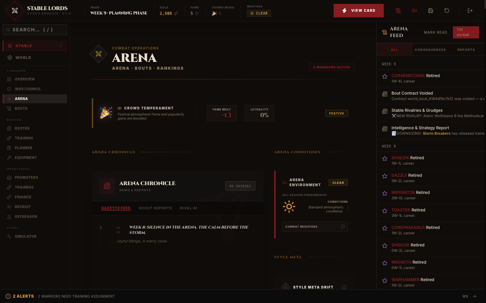

### The Stable Hub

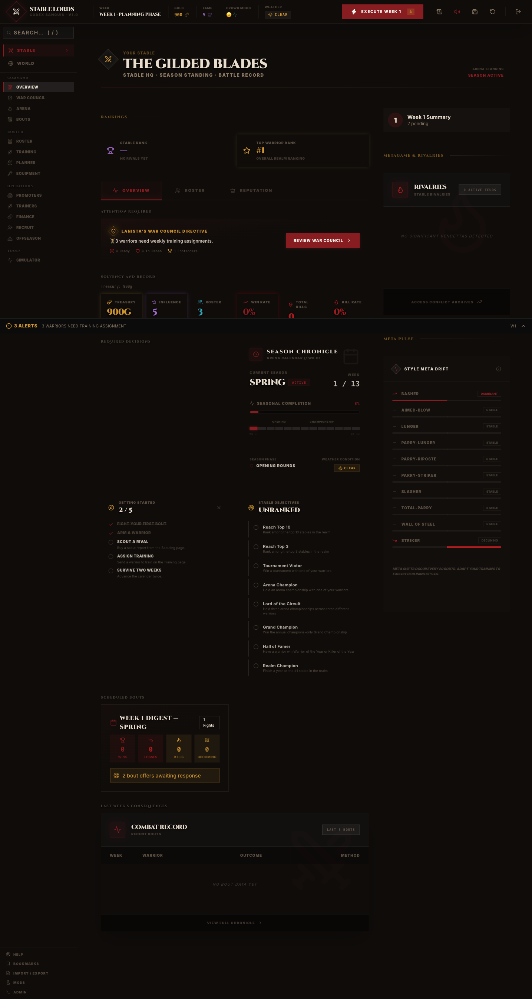

| Page | What you do there |
| --- | --- |
| **Overview** | Dashboard — objectives, next bout, medical audit, arena conditions, style meta |
| **War Council** | Advisor recommendations + autopilot toggle |
| **Arena** | Combat operations — crowd temperament, arena conditions, meta drift |
| **Bouts** | Booking office — accept/decline bout offers |
| **Roster** | Your warriors — status, plans, quick actions |
| **Training** | Assign weekly training regimens |
| **Planner** | Fight plans for every warrior |
| **Equipment** | Outfit your roster |
| **Promoters** | The promoters working your circuit and their offers |
| **Trainers** | Hire and manage trainers |
| **Finance** | The ledger — every transaction, categorized |
| **Recruit** | The intake pool + free agents |
| **Offseason** | Season-boundary preview |

### The World Hub

| Page | What you see there |
| --- | --- |
| **Rankings** | League table of stables + warrior rankings + world census |
| **Arenas** | The full circuit — every venue, its crown, its tier |
| **Tournaments** | Seasonal tournament brackets and history |
| **Prep Mode** | Tournament-week planning surface |
| **Scouting** | Order intel reports on rival warriors |
| **Style Archives** | The meta archive — how each style is performing realm-wide |
| **Chronicle** | The Gazette — weekly news issues |
| **Hall of Fame** | Immortal warriors and stables |
| **Hall of Fights** | Legendary recorded bouts |
| **Graveyard** | Fallen warriors — yours and the world's |

### Utility

| Page | Purpose |
| --- | --- |
| **Simulator** | Physicals simulator — sandbox tool for testing builds |
| **Help** | The in-game Codex (condensed reference) |
| **Bookmarks** | Everything you've pinned — warriors, stables, offers |
| **Import / Export** | Save-pack management |
| **Mods** | Content packs and house rules |

---

## 6. Warriors

Warriors are the heart of the game. Each has **attributes**, derived **combat skills**, a **fighting style**, **traits**, equipment, and a career record — everything on their **dossier** page.

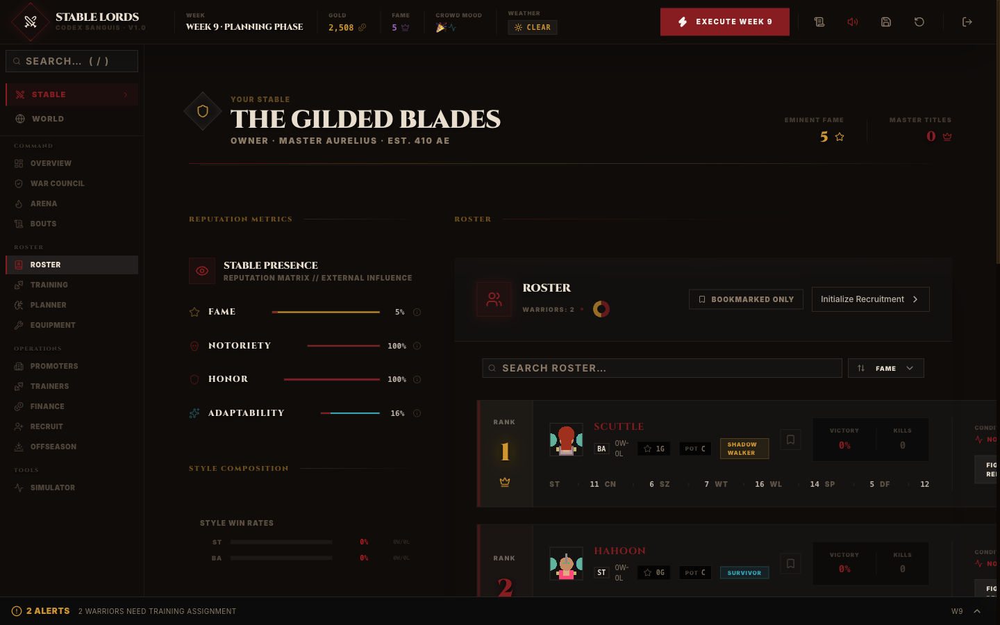

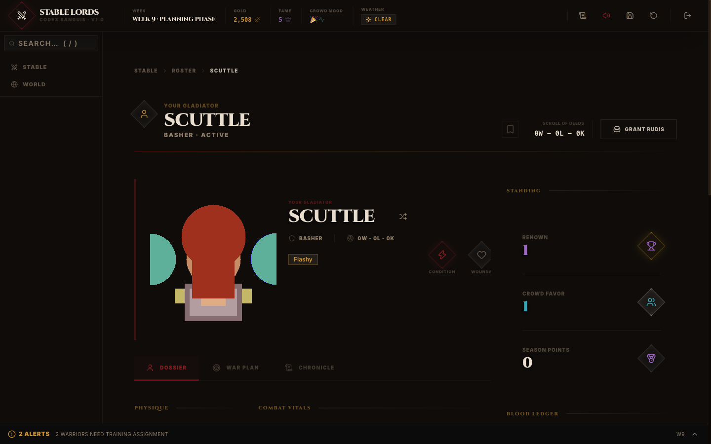

### 6.1 Attributes

Seven core attributes, each from **3** (floor) to **25** (hard cap). A standard new warrior is built on a **70-point allocation**:

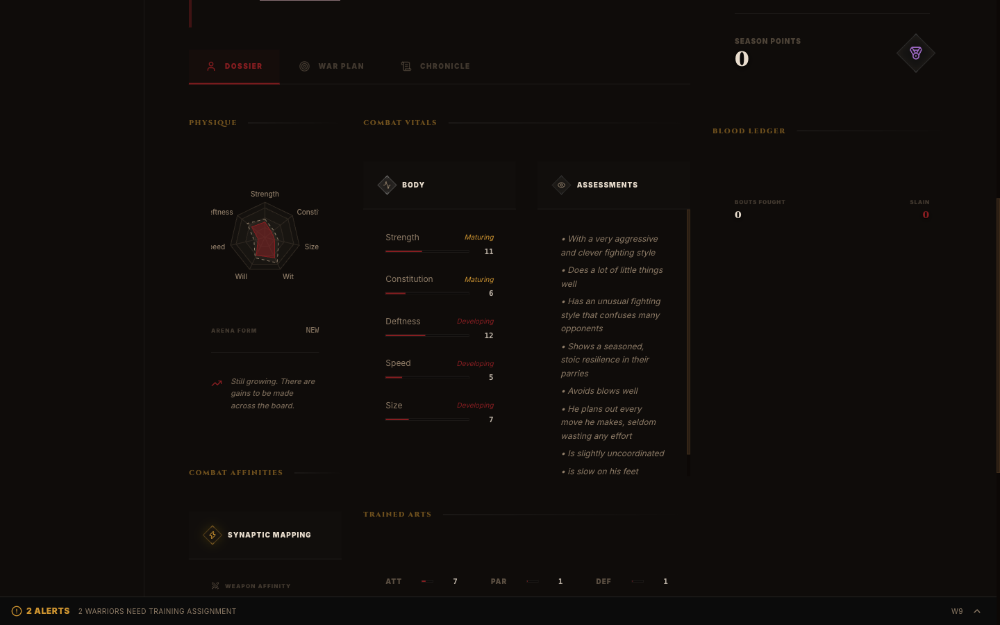

| Attribute | Abbr. | What it feeds |
| --- | --- | --- |
| Strength | ST | Damage dealt; Endurance; Attack |
| Constitution | CN | Hit Points; Endurance; absorbing punishment |
| Size | SZ | Hit Points; modifies INI/PAR/DEF (big hits harder to dodge; small is harder to hit) |
| Wit | WT | Initiative (sharp breakpoint at 11+); feinting; learning speed |
| Will | WL | Endurance; morale; resisting collapse and finishing blows |
| Speed | SP | Movement; Defense |
| Deftness | DF | Riposte; precision; weapon work |

Each attribute displays a **growth tag** on the dossier (_Developing_, _Maturing_, and so on) — a hint at how much headroom remains before that attribute's hidden ceiling (§6.5).

- **Hit Points** derive from CN × 2 plus SZ and WL modifiers.
- **Endurance** derives from a table built on WL × 3 + ST + CN.
- **Size cannot be trained.** Everything else can, within its ceiling.

### 6.2 Combat Skills

Six skills are **derived** from attributes via a breakpoint table, then improved further through arena lessons and drilling. They run 1–20:

| Skill | Abbr. | What it does |
| --- | --- | --- |
| Attack | ATT | Landing hits |
| Parry | PAR | Active blocking |
| Defense | DEF | Passive evasion |
| Initiative | INI | Acting first in exchanges |
| Riposte | RIP | Counter-attacking after a parry |
| Decisiveness | DEC | Pressing advantages and seizing openings |

Raising attributes raises the skills they feed: ST→ATT, DF→RIP/INI, WT→INI (big spike at 11+), SP→DEF, SZ→INI/PAR/DEF modifiers.

### 6.3 Fighting Styles

Every warrior fights in one of **10 styles** — their class, chosen at intake and permanent. Each has its own stat demands, tempo, strengths, and vulnerabilities. Display names in the UI show the warrior's style moniker:

| Style | Moniker | Identity |
| --- | --- | --- |
| Aimed Blow | Aimed-Blow | Surgical striker; rewards WT + DF; deadly precision, fragile margins |
| Bashing Attack | Basher | Brute force; rewards ST + SZ; hits through armor |
| Lunging Attack | Lunger | All-in aggression; rewards ST + SP; explosive, exhausts fast |
| Parry-Lunge | Parry-Lunger | Bait and punish; balanced offense/defense |
| Parry-Riposte | Parry-Riposte | Counter-fighter; rewards DF/RIP; wins on the reply |
| Parry-Strike | Parry-Striker | Methodical patient blade; rewards CN + PAR |
| Slashing Attack | Slasher | Fast flurries; rewards SP + DF; volume over single hits |
| Striking Attack | Striker | Heavy single strikes with reach; rewards ST + WT |
| Total Parry | Total-Parry | Pure defense; outlasts almost anything, wins little |
| Wall of Steel | Wall of Steel | Offense and defense together; rewards all-round stats |

**Matchups matter.** Style-vs-style relationships are real — some styles feast on others, and the realm's **meta drift** (§17) tracks which styles are fashionable. The **Style Archives** page shows how each style is actually performing realm-wide this season — the closest thing to a live matchup matrix the game will hand you.

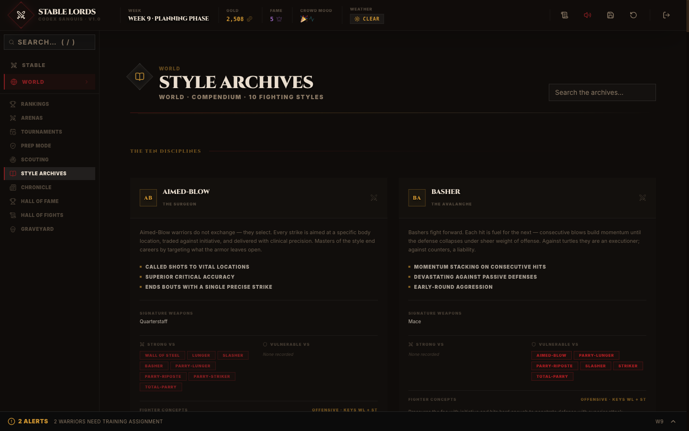

### 6.4 Traits & Assessments

Warriors also carry **traits** — permanent quirks with real mechanical effects. The full trait lexicon runs ~180 entries across several tiers:

- **Common** — everyday modifiers
- **Notable** — meaningful combat or economic effects
- **Exceptional** — strong conditional bonuses
- **Signature** — rare, defining abilities
- **Flaws** — genuine handicaps
- **Class traits** — style-specific boons

Effects range from static skill bonuses and kill-window modifiers to disarm interactions, unarmed damage, personality quirks, and attribute boosts. You don't choose traits — you discover them through intake assessments, scouting, and watching the warrior fight.

The dossier's **Assessments** panel translates what the trainers see into prose: _"does a lot of little things well"_, _"avoids blows well"_, _"is slow on his feet"_. These map to real numbers underneath — treat them as scouting blurbs for your own roster.

### 6.5 What the Game Keeps Hidden

Some values are deliberately obscured — the game wants you to _learn_ a warrior, not read a stat block:

- **Attribute potential** — every attribute has a personal ceiling. You discover it by training the attribute until it stops growing (the growth tag on the dossier is the visible hint).
- **Favorite weapon** — each warrior has one weapon they handle better. The weapon chart builds with every bout until it becomes apparent.
- **Favorite rhythm** — a hidden OE/AL combination the warrior naturally thrives at.
- **Favorite learn** — the skill a given warrior absorbs fastest from arena lessons.
- **Luck** — a hidden per-skill modifier rolled at creation.
- **Bloodlust** — a hidden disposition that subtly warps how a warrior behaves in lethal moments.

The manager's job is charting: bout logs, weapon charts, lesson reports, and the odd insight token slowly turn strangers into known quantities (§10, §18).

---

## 7. Recruitment & Free Agents

Your roster cap is **10 warriors** (base — roster bonuses can raise it). Fresh blood comes from the **Recruit** page:

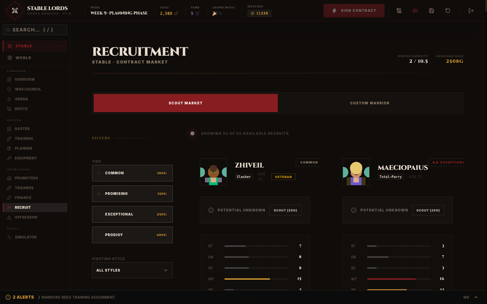

- **Intake pool** — a batch of recruits refreshes automatically; reroll it for **50g** when nothing appeals.
- **Free agents** — experienced warriors between stables occasionally appear here. They cost more but arrive with records, skills, and sometimes reputations.

### Recruit Tiers

Each recruit is priced by **tier**, shown as a star rating with a visible point-total range:

| Tier | Cost | Stars | Attribute total |
| --- | --- | --- | --- |
| Common | 100g | ☆ | 66–70 |
| Promising | 150g | ★ | 70–74 |
| Exceptional | 250g | ★★ | 74–78 |
| Prodigy | 400g | ★★★ | 78–82 |

Every recruit shows physique, recommended style, and attribute spread before you buy. **Buy for style fit, not totals** — a 70-point warrior whose points feed their style will beat an 80-point warrior whose don't (§23).

---

## 8. Training & Trainers

Every week, each warrior can be assigned **one regimen** on the Training page. Training costs **20g per warrior**; an unassigned warrior idles — they still draw upkeep and learn nothing, so keep them working.

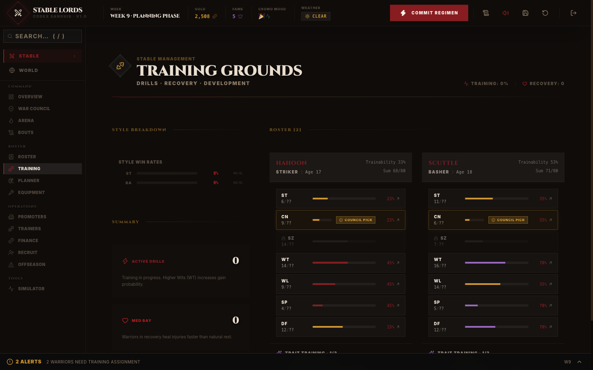

### Regimens

| Regimen | What it does |
| --- | --- |
| **Attribute training** | Chance (~55% base, +5% per point of WL) to gain +1 in a chosen attribute |
| **Skill drilling** | +1 to a chosen combat skill — each skill caps at 3 drills |
| **Trait training** | Assign a trainer to coach one warrior for **4 weeks**; the outcome — a new positive trait, an accidental flaw, or nothing — arrives when the course ends. A warrior can hold at most **3 traits**, and the trainer's tier caps how rare the learnable traits can be (Novice → Notable, Seasoned → Exceptional, Master → Signature). |
| **Recovery** | Reduces remaining weeks on an injury — always assign it to the wounded |

Training obeys seasonal limits:

- Each **attribute** can gain at most **3 points per season**.
- Repeating the **same attribute** within a season halves the gain chance.
- Every gain attempt carries a **3% injury risk** (clamped 1–10%, softened by better trainers).

### Trainers

Hired trainers improve gain odds and blunt injury severity. They draw a weekly salary and their bonuses apply roster-wide.

| Tier | Salary | Effect |
| --- | --- | --- |
| Novice | 10g/week | Baseline |
| Seasoned | 25g/week | Better gain odds, softer injuries |
| Master | 75g/week | Strongest gains + a **specialty** (healing, a specific attribute, or a skill) |

Trainers age and die too — they start around 45, retire from 65, and none are immortal. A Master with the **Healing** specialty materially shortens injury recovery; a **WT specialist** helps prospect warriors hit that critical WT 11 breakpoint (§6.2).

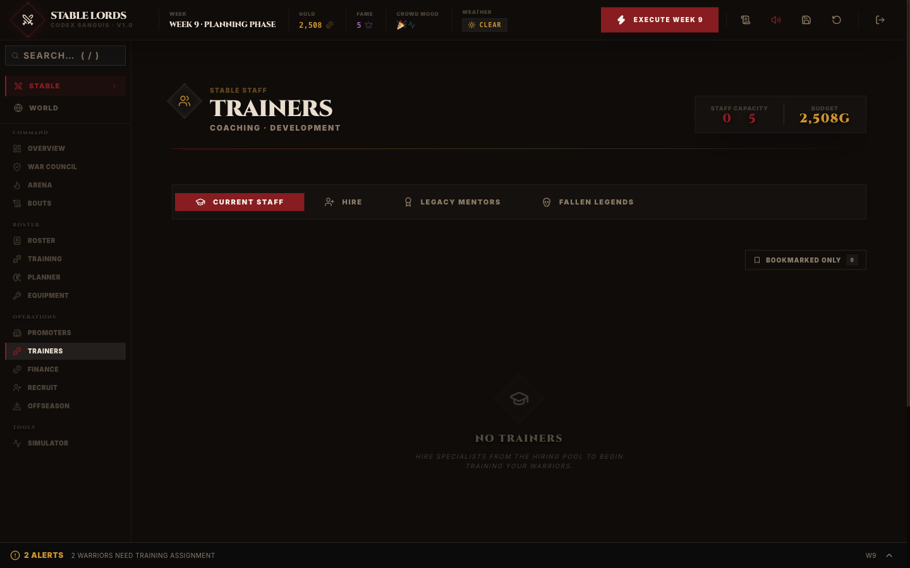

### Arena learning

Fighting teaches too. Each bout gives a warrior up to **six learning attempts** (weighted toward WT), worth up to +6 per skill over a career (career cap 24 total). A warrior fighting near their **favorite learn** and favorite rhythm learns noticeably faster — and a **suspected favorite** marker appears once the chart has enough evidence (§6.5).

---

## 9. Equipment

Every warrior carries a **weapon**, **armor**, and **helm** into the arena. Equipment is assigned per warrior on the Equipment page — watch the encumbrance, because heavier loads drain endurance and drag speed-based skills down.

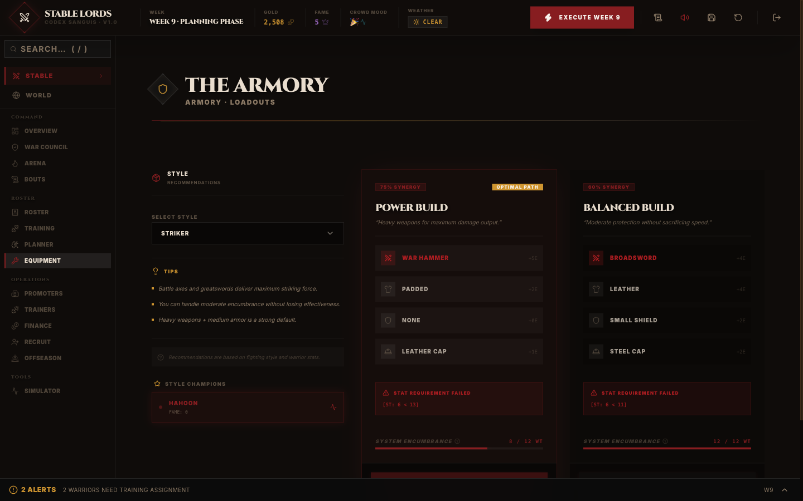

### Weapons (22)

Fist · Dagger · Epée · Hatchet · Shortsword · Scimitar · Short Spear · Broadsword · Longsword · Long Spear · Mace · Morning Star · War Flail · War Hammer · Small Shield · Medium Shield · Large Shield · Quarterstaff · Great Axe · Greatsword · Battle Axe · Halberd · Maul

Shields count as off-hand weapons and pair with parry-based styles; two-handed weapons preclude them. Every style has weapons it's **well suited** to (the planner and equipment screens flag these) — and every warrior secretly has one **favorite** weapon regardless of style (§6.5). Chart it.

### Armor (9)

| Weight | Options |
| --- | --- |
| Unarmored | None |
| Light | Padded, Leather, Studded Leather |
| Medium | Ring Mail, Scalemail, Chainmail |
| Heavy | Platemail, Plate Armor |

### Helms (5)

None · Leather Cap · Steel Cap · Helm · Full Helm

> **Rule of thumb:** armor trades endurance and speed for damage mitigation. Total Parries can carry full plate; Slashers and Lungers should stay light. Head protection matters — head hits are the most lethal (§11).

---

## 10. Fight Plans

The **fight plan** is your pre-bout instruction set — written per warrior on the **Planner** page and revisited constantly. The planner scores each plan (the **Strategy Score**) and simulates the warrior's **stamina curve** so you can see a collapse coming before it happens.

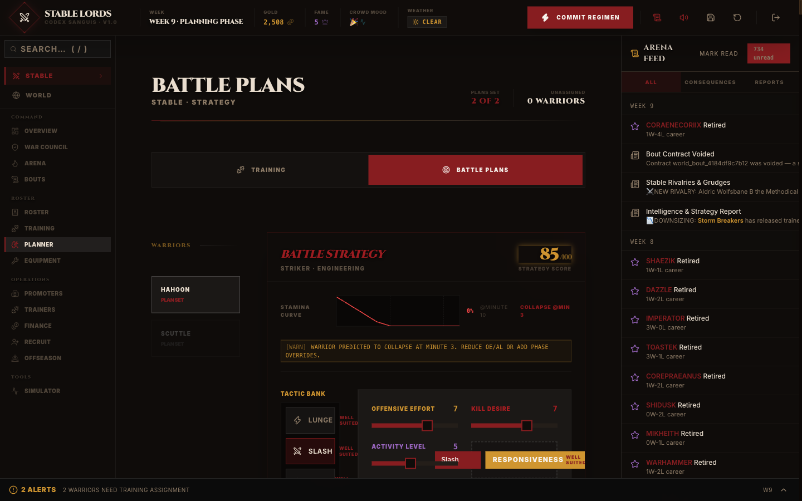

### The core dials

| Dial | Range | What it controls |
| --- | --- | --- |
| **Offensive Effort (OE)** | 1–10 | How hard the warrior presses attacks — burns endurance fast |
| **Activity Level (AL)** | 1–10 | How much the warrior moves and repositions — steadier endurance drain |
| **Kill Desire (KD)** | 1–10 | Willingness to press kill opportunities when they open |

OE and AL together are the warrior's **rhythm** — every warrior has a hidden favorite combination (§6.5), and the planner flags when your settings look unsuited (_"well suited"_, _"poorly suited"_ on tactics).

### Tactics

| Slot | Options |
| --- | --- |
| **Offensive tactic** | Lunge · Slash · Bash · Decisiveness · none |
| **Defensive tactic** | Dodge · Parry · Riposte · Responsiveness · none |

Tactics modify whole exchanges — a well-suited Lunge or a Riposte counter-game can flip a matchup. The tactic bank shows suitability ratings per warrior.

### The deeper plan

Beyond the dials, plans support:

- **Target and protect** — aim at a body area; cover your own weak zone
- **Phase plans** — different instructions for the opening, mid, and late fight
- **Desperate plan** — what to do when the fight is being lost
- **Conditions** — triggers on HP, momentum, endurance, phase, opponent state, tactic streaks, or psychology
- **Feint tendency** and **decoy** axes — misdirection settings
- **Range preference** — Grapple / Tight / Striking / Extended
- **Context plans** — separate instructions for challenges and tournament bouts

> **The stamina warning is the plan's smoke detector.** _"Warrior predicted to collapse at minute 3 — reduce OE/AL or add phase overrides"_ means your rhythm outspends the warrior's endurance. Either lower the dials, or open hard and shift to a cheaper late plan — that's what phase overrides exist for.

---

## 11. Combat — How Bouts Resolve

Combat is fully simulated: a bout plays out as a series of **exchanges** — at most **30**, grouped three per arena minute for a ~10-minute horizon — and narrated in the bout transcript.

### Phases

- **Opening** — range is established; high-initiative fighters dictate terms
- **Mid** — the main body of the fight; most exchanges happen here
- **Late** — fatigue bites; kill windows open; desperation sets in

### What an exchange contains

Initiative → attack → the defender's response (dodge / parry / riposte) → riposte counters → damage → endurance drain → fatigue checks — layered with **momentum**, **feints**, **range shifts**, **zone shifts**, knockdowns, disarms, and crowd-pleasing flourishes.

### Space matters

Arenas are physical places:

- **Ranges** — Grapple, Tight, Striking, Extended. Fighters drag each other across the range ladder; weapons and styles have preferred bands.
- **Zones** — Center, Edge, Corner, Obstacle. Zone position modifies defense; corners are dangerous.
- **Arena size** — Cramped, Standard, Open venues change how the range game plays.
- **Surfaces & hazards** — some venues have water hazards or terrain effects that touch initiative, endurance, or riposte.

### Bout outcomes

A bout ends by one of: **Kill · KO · Stoppage · Exhaustion · Decision · Yield · Draw**.

- **Kill window** opens when a fighter's endurance drops below **40%** and HP below **30%** — kill probability scales with how deep they're gone, the hit location, the attacker's skill, KD, momentum, phase, and the defender's WL and injuries, up to a **12% per-exchange cap**.
- **Exhaustion** — at zero endurance a fighter isn't automatically stopped; the referee only steps in if HP is also below **45%**. A dry fighter with health left can still fight — badly.
- **KO** — sufficient head/chest trauma ends it outright.
- **Decision** — the judges score what the crowd saw.

### Reading a transcript

The narration tells you *why*: _"slips inside the guard,"_ _"the crowd gasps as the blade bites deep,"_ _"staggers, clearly winded."_ Watch for your warrior's weapons landing vs. bouncing, their preferred range, where they got tired — it all feeds the next plan (§10) and the next booking (§13).

---

## 12. Injuries, Aging & Death

### Injuries

Injuries come from combat and training. Each carries a severity and a recovery clock — visible on the dossier's **wounds** panel and the medical audit.

- Assign **Recovery** training — it shortens the clock.
- A **Master (Healing) trainer** shortens it further.
- Fighting injured is legal and sometimes necessary — but it multiplies lethality in the kill window.
- **Permanent** injuries never heal; enough of them force retirement.

### Aging

Warriors age one year every 52 weeks (careers start at ~18):

- Decay begins after **25** — physical attributes (SP, DF) erode by a step every **3 years** past the threshold.
- From **26 onward** retirement risk starts rolling; by **32** it's effectively forced.
- A typical productive career runs 5–10 in-game years. Retire them before the sand retires them — the **Grant Rudis** button on the dossier retires a warrior cleanly, preserving their name and record.

### Death

Death is permanent. There is no resurrection.

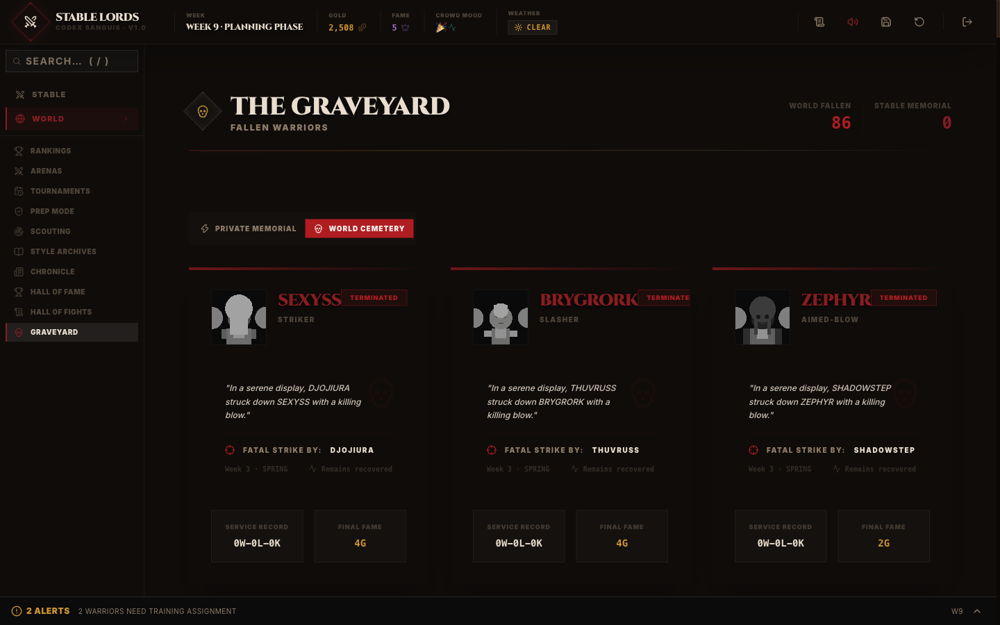

The fallen get a memorial: cause of death, the fatal opponent, service record, final fame, and an epitaph. Under the default house rules a killing blow kills — mods (§22) can soften this into severe injuries if you'd rather run a kinder world.

---

## 13. Booking Fights

Warriors earn nothing without bookings. Each week, promoters route **bout offers** to the **Bouts** page:

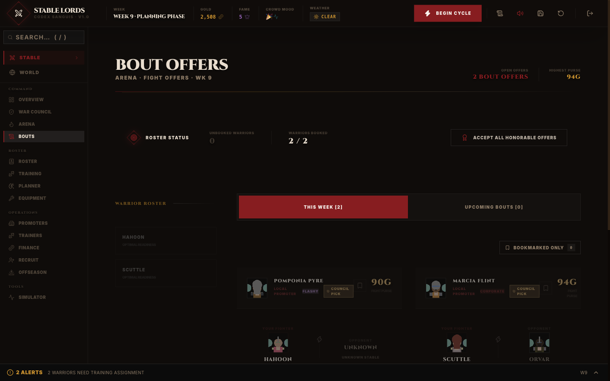

Each offer shows the opponent (name, style, record — as much as your scouting knows), the purse, the arena, and an expiry. Accept, decline, or let it lapse. One bout a week per warrior is the natural cadence — more invites overwork — and a **Moderate or worse injury blocks bookings outright**.

### Promoters

Five personalities work the circuit:

| Personality | Their offers |
| --- | --- |
| Greedy | Big purses, dangerous matchups |
| Honorable | Fair matchmaking, reliable payouts |
| Sadistic | Underdog feedings, crowd-pleasing blood |
| Flashy | Spectacle and theatrical staging |
| Corporate | Steady, low-risk, low-reward |

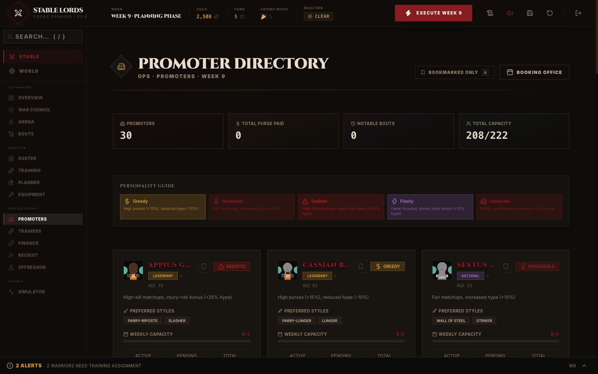

Promoters remember. Taking their offers builds the relationship; repeatedly declining cools it.

### Challenges, avoids & rivalries

- **Challenge** a rival warrior directly — they may refuse.
- **Avoid** flags a warrior or a whole stable as off-limits for matchmaking.
- **Rivalries** ignite through repeated matchups and bad blood — rivalry bouts carry higher purses, higher stakes, and hotter narration. Owner-level **grudges** exist too; some opponents hold long memories.

---

## 14. The Treasury

Gold keeps the whole machine running. The **Finance** page is a full ledger — every purse, salary, and fee, week by week.

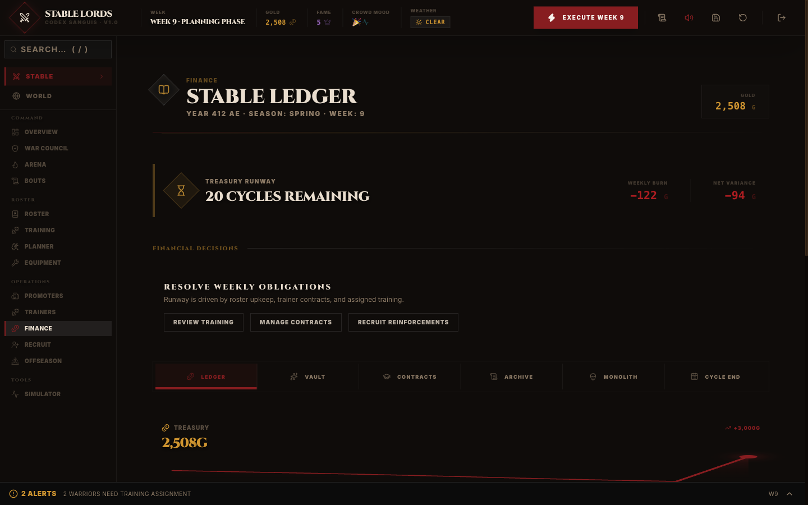

### Income

| Source | Amount |
| --- | --- |
| Fight purse | 90g base × arena multiplier (tier 1 ×1.0 · tier 2 ×1.5 · tier 3 ×2.25), plus fame scaling |
| Win bonus | 35g base, same scaling |
| Fame dividend | 0.5g per point of fame, per week |
| Noble patronage | (fame − 40) ÷ 10 × 25g per famous warrior — kicks in above 40 fame |
| Arena title purse | ×1.5 on championship bouts |

Fame's purse contribution is capped at 60 points' worth, so a legend's real money comes from patronage and tier-3 venues.

### Expenses

| Item | Cost |
| --- | --- |
| Warrior upkeep | 60g + 1.5g × fame, per warrior per week |
| Training | 20g per session |
| Trainer salaries | 10 / 25 / 75g per week by tier |
| Scout reports | 25 / 50 / 100g by tier |
| Intake reroll | 50g |
| Recruits | 100–400g by tier |

### Insolvency

Cross below **−500g** and the bank comes calling — a **Bankruptcy Crisis** hits the newsletter and your popularity drops 50:

- **More than 2 warriors on roster:** your highest-fame warrior is **forcibly sold** for fame × 10 gold to cover debts. It is exactly as bad as it sounds.
- **At the roster floor (2 warriors):** an **emergency loan** (up to 300g) is injected to pull you back toward the threshold — but the debt floor is **−800g**, and it will not catch you forever.

Small mercies: a **25g idle stipend** arrives in weeks where your stable fights no bouts at all, and the app raises an IMPENDING INSOLVENCY warning before the treasury actually breaks. Win a bout, release a warrior, drop a trainer — do whatever it takes before the ledger does it for you.

> **Keep a war chest.** One bad week — a death, a trainer bill, a recruit you had to have — can strand a stable that lives paycheck to paycheck.

---

## 15. The Arena Circuit

The realm holds **dozens of venues** — from the Proving Grounds and the Bloodsands to stranger ground like the Flooded Vault, the Crystal Cavern, and the Mudpit.

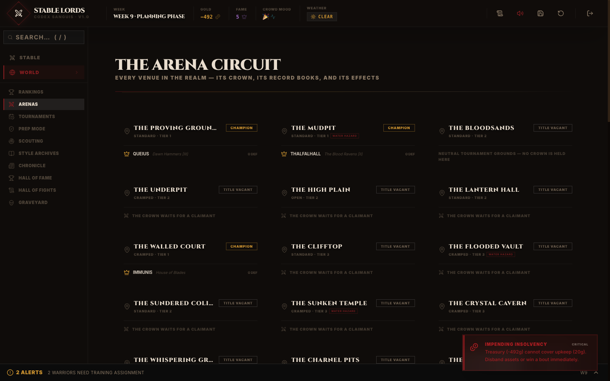

Each venue card shows its **size** (Cramped / Standard / Open), **tier** (1–3 — which multiplies purses), any **hazards** (water hazard and friends), and its **crown**: the reigning arena champion or _TITLE VACANT_.

### Arena championships

Every arena runs a title:

- A warrior needs **3+ bouts at that venue** to contend.
- Champions are scheduled to **defend roughly every 4 weeks**; refuse twice (outside medical exemption) and the crown is stripped.
- Defeated challengers wait **8 weeks** before re-challenging; deposed champions wait **26 weeks** before contending again.
- Titles decay with **dormancy** — hoard a crown without fighting and it comes loose.
- Title bouts pay **×1.5**, carry +50 hype, and an active reign trickles the champion **+2 fame / +1 popularity** a week.

Claim crowns deliberately — an arena title is one of the eight progression objectives (§21), and **Lord of the Circuit** demands three at once.

---

## 16. Tournaments & the Grand Championship

The year has rhythm. Tournaments run on **weeks 10, 20, 30, and 42** — one per season, give or take — at neutral venues, and the whole season ends with the Grand Championship on **week 52**.

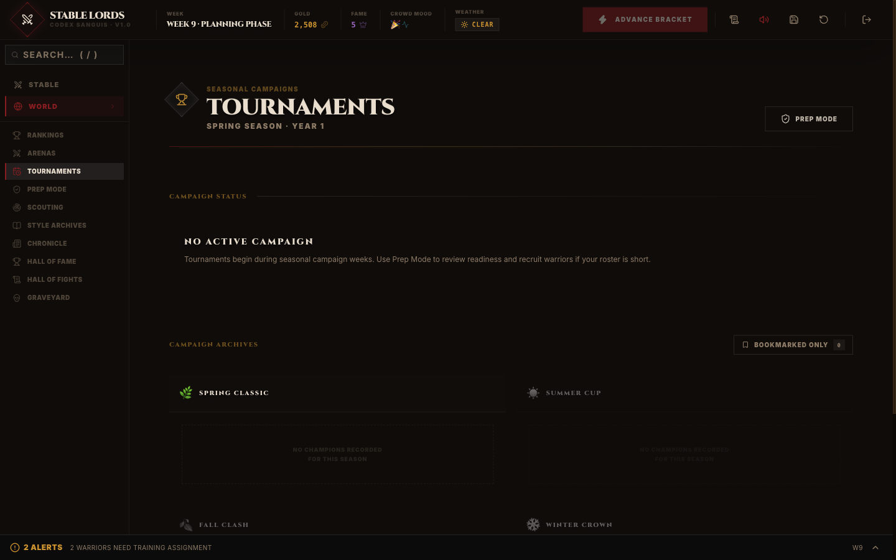

### Seasonal tournaments

Each seasonal tournament brackets the realm's warriors into four tiers by ranking:

| Tier | Field | Name |
| --- | --- | --- |
| Gold | ranks 1–64 | Imperial Gold Cup |
| Silver | ranks 65–128 | Proconsul Silver Plate |
| Bronze | ranks 129–192 | Steel Bronze Gauntlet |
| Iron | ranks 193–256 | Foundry Iron Trials |

Tournament week changes everything: entry lists, seedings, and bracket odds appear on the **Prep Mode** page — a dedicated planning surface for writing tournament-specific plans and managing your entrants before the draw runs.

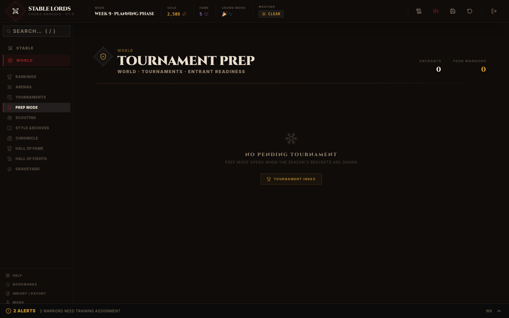

Tournament wins feed fame, medals, legacy — and the **Tournament Victor** objective.

### The Grand Championship (Week 52)

The season finale at **The Iron Cage**: living arena champions only, field capped at 64 (cancelled if fewer than 4 living champions remain), purse **2,500g**, winner's fame **+25**, popularity **+10**, and the title **Grand Champion** — one of the rarest lines a warrior can carry, and a progression objective unto itself.

---

## 17. The Living World

Your stable is one of many. The realm runs itself whether you watch or not.

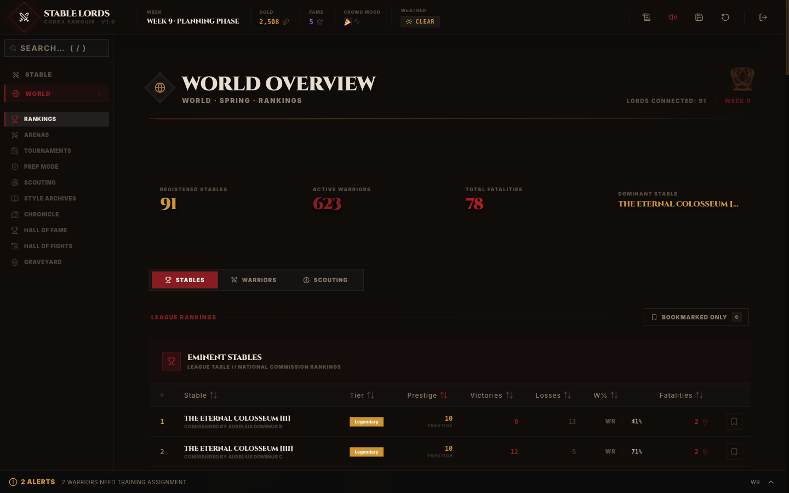

- **Rival stables** — the world opens with 8 rival stables and grows toward a living ecosystem (roughly 90 stables at the floor, ~160 at the soft cap, 200 hard). Each has an owner personality, competence rating, favored styles, economy, and its own roster to feed and bury. Stables recruit, train, go broke, fold, and are replaced by **legacy founders**.
- **Rankings** — the league table sorts stables by prestige; individual warrior rankings drive tournament seeding.
- **Crowd mood** — Calm, Bloodthirsty, Theatrical, Solemn, or Festive each week; moods shift favor multipliers and lethality (a bloodthirsty crowd is visibly more dangerous).
- **Weather** — 60+ weather types roll through the calendar, from mundane Clear and Rainy to Arcane Storms and worse. A dozen impossible weathers are reserved for the offseason (§20). Weather modifies arena conditions and combat.
- **Meta drift** — the realm's taste in styles evolves weekly: whatever wins gets imitated; whatever's common gets countered. The Arena page's Style Meta drift and the Style Archives chart it live.

The Arena Feed on the right rail is how the world talks to you: retirements, voided contracts, fresh rivalries, downsizings — read it like a wire service.

---

## 18. Scouting

Scouting buys certainty. Order a report on any rival warrior from the **Scouting** page:

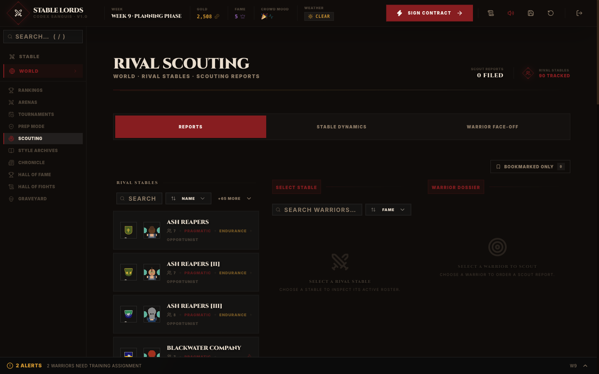

| Tier | Cost | Precision |
| --- | --- | --- |
| Basic | 25g | rough numbers (±5 variance) |
| Detailed | 50g | tighter estimates (±3) |
| Expert | 100g | near-exact (±1) — plus plan intel, persona read, traits (probabilistically), and owner competence |

Reports land in your scout archive and sharpen the opponent card on future offers — you'll see real attribute bands instead of shrugs. Until you've scouted a warrior, their dossier is **fog of war**: record and style visible, attributes hidden.

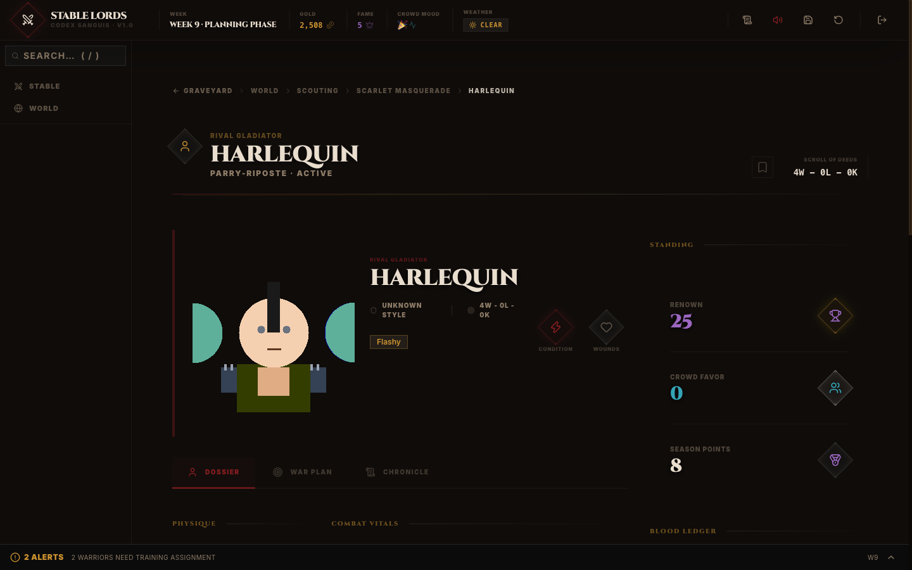

> **Spend scouting on decisions, not curiosity.** Scout the opponent you might actually book: a dangerous name before a big purse, the bracket favorites before tournament week.

**Insight tokens** — earned through play — can be spent in the booking office or treasury for decisive pre-fight advantages (see the in-game Codex's tokens section).

---

## 19. News, Memory & Legends

- **Chronicle / Gazette** — the weekly newspaper: bout results, deaths, upsets, standings, meta commentary, rumors. The Arena page hosts the same content under Arena Chronicle.

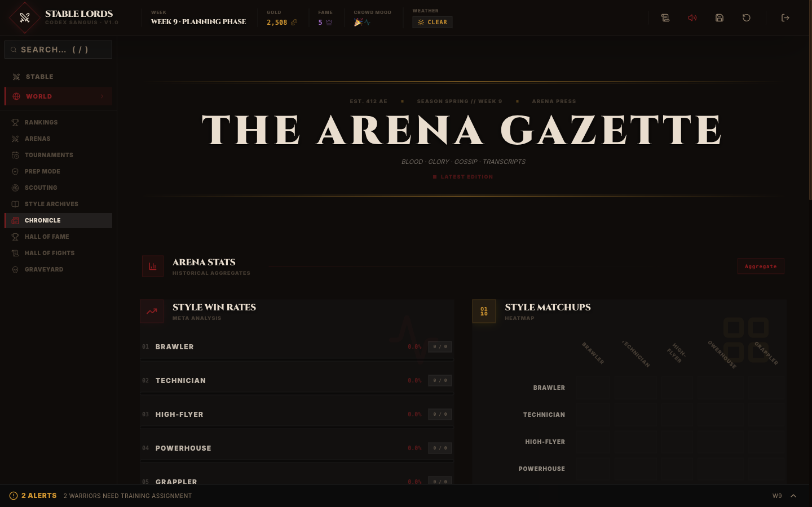

- **Hall of Fame** — the immortal warriors and stables: records, titles, and legends of the realm.

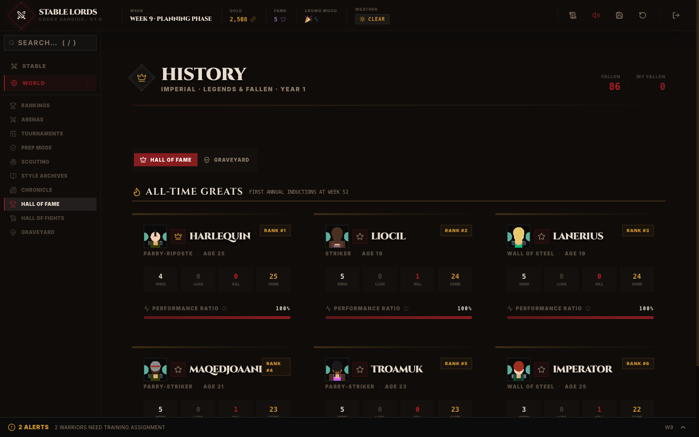

- **Hall of Fights** — legendary recorded bouts, preserved with their full transcripts.

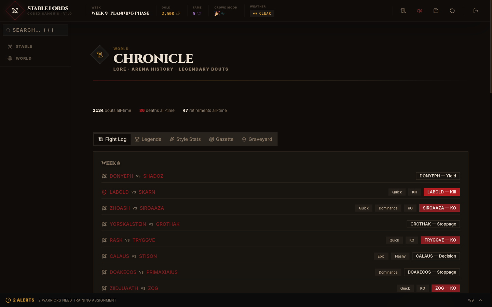

- **Graveyard** — two tabs: **Private Memorial** (your fallen) and **World Cemetery** (the realm's). Every death is archived — who killed them, when, their final fame.
- **Bookmarks** — pin warriors, stables, promoters, trainers, tournaments, offers, and scout reports for quick access.
- **Event log** — the bell icon replays notifications you missed.

The in-game **Help Codex** (left rail, bottom) is a condensed version of this manual — good for quick reference mid-week.

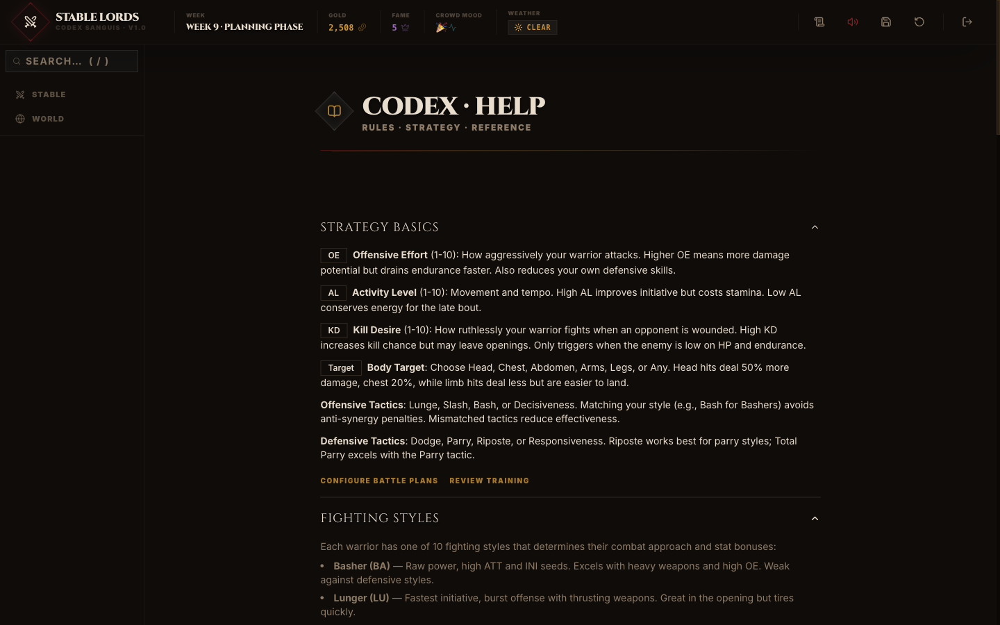

---

## 20. The Offseason

Crossing from week 52 to week 1 fires the seasonal pipeline: annual awards are handed out, warriors and trainers age a year, retirement rolls are made, rosters churn, champions are audited — and then the world rolls **one offseason event** from a pool of ~70.

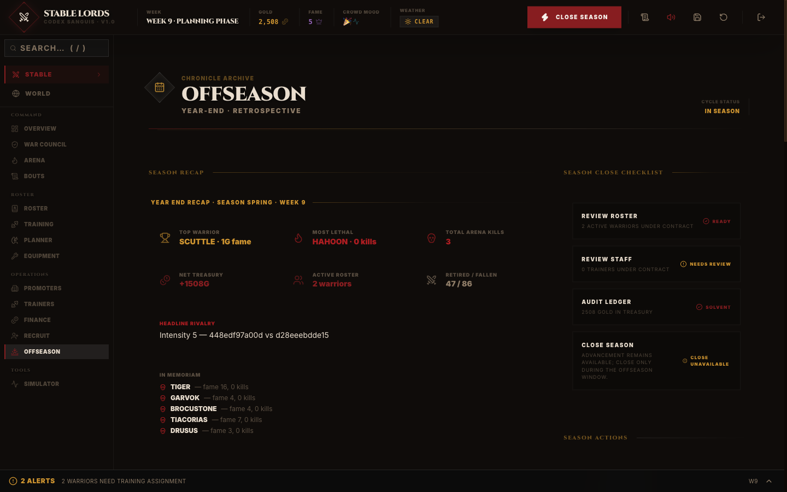

Most are benign season-flavor — festivals, merchant blessings, wandering healers. Some are strange: Chaos Rifts, Shadow Tournaments, Temporal Anomalies, Goblin Raids. A dozen impossible weathers (Eclipse of Chaos, Diamond Rain, Moonlight Duel, Threads of Chaos…) exist **only** as offseason phenomena — you'll never see them in the regular season.

You don't control the roll. You just live with what the realm does next.

---

## 21. Objectives & Victory

Eight objectives track your stable's climb. They're checked automatically and surfaced on the Stable overview:

| # | Objective | Requirement |
| --- | --- | --- |
| 1 | **Reach Top 10** | Rank among the realm's top 10 stables |
| 2 | **Reach Top 3** | Rank among the top 3 |
| 3 | **Tournament Victor** | Win a seasonal tournament with one of your warriors |
| 4 | **Arena Champion** | Hold an arena championship |
| 5 | **Lord of the Circuit** | Hold three arena championships across three different warriors |
| 6 | **Grand Champion** | Win the champions-only Grand Championship |
| 7 | **Hall of Famer** | A warrior wins Warrior of the Year or Killer of the Year |
| 8 | **Realm Champion** | Finish a year as the #1 stable in the realm |

**Realm Champion** is the win condition — evaluated at the year boundary. Winning opens the victory screen: continue in **legacy mode** (keep playing; the realm doesn't stop) or start a new stable.

---

## 22. Saves, Mods & Tools

### Saves

- **10 save slots**, managed on the title screen.
- **Autosave** after every weekly simulation — close the game anytime mid-week without losing anything.
- **Import / Export** — pack a save to a file (JSON/YAML) for backup or sharing; import restores it to a slot.

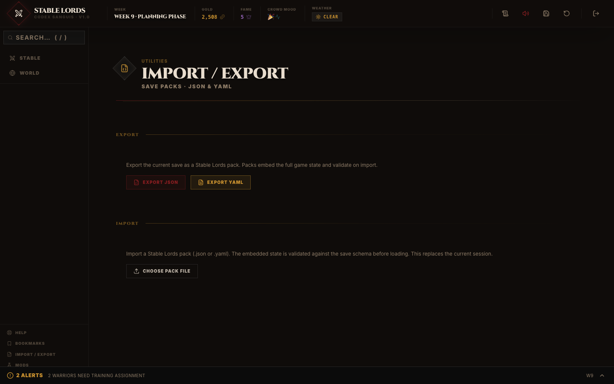

### Mods & house rules

The **Mods** page manages content packs and house rules — alternate data sets (arenas, names, lore) and rule variants (e.g., turning fatal blows into severe injuries instead of deaths).

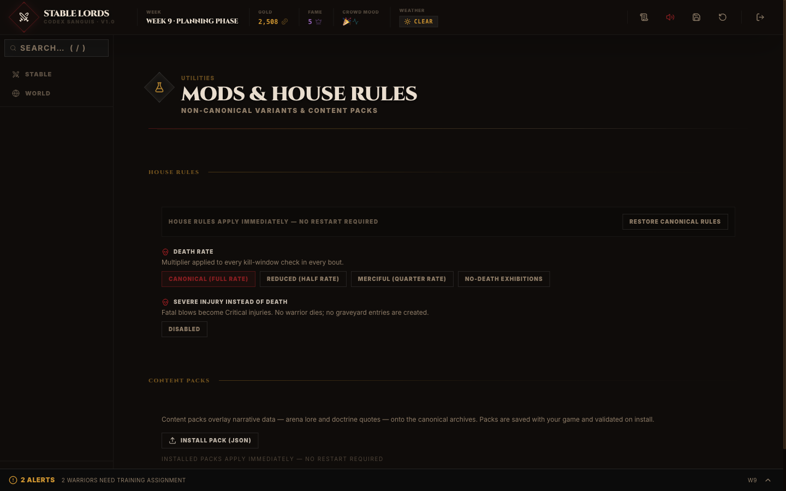

### Simulator

The **Physicals Simulator** is a sandbox: build warriors by hand and test physiques, styles, and plans without spending a save slot's gold or blood. Excellent for learning what a "good" Parry-Riposte actually looks like.

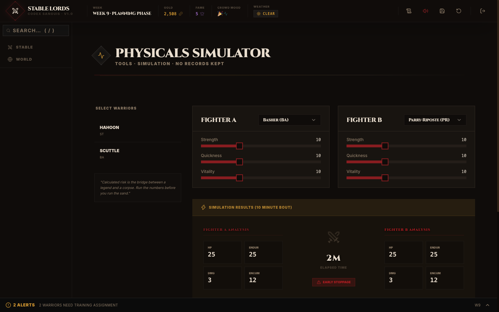

---

## 23. A Manager's Playbook

Hard-won advice for the first seasons:

**Opening weeks**

- **Fight every week you can afford.** Arena lessons and purses are the only income that compounds; a warrior who never fights never learns.
- **Keep 3 warriors working, not 10.** Upkeep is 60g+ a head; a lean roster that wins beats a fat one that eats.
- **Take Corporate and Honorable purses early.** Sadistic and Greedy promoters pay more — for fights your rookies may not survive.
- **Bank ~200g minimum** before recruiting or upgrading trainers.

**Reading recruits**

- Attribute totals lie; **distribution** doesn't. Check that a candidate's best attributes feed the skills their style rewards — DF/WT for Aimed-Blow and Parry-Riposte, ST/SZ for Bashers, speed for Slashers and Lungers.
- WT 11+ is the single most valuable breakpoint — it wakes Initiative up.
- Traits and assessments are worth more than the star rating.

**Fight plans**

- The stamina curve is the plan's truth — **never book a warrior whose plan predicts collapse**. Lower OE/AL or open hard then shift cheap with phase overrides.
- High KD kills — both ways. Raise it on killers you trust; keep it modest on prospects you can't replace.
- Match the plan to the scouting report, not the mood: defensive tactics into heavy hitters, tempo into slow defensive styles.

**Season play**

- Book toward a **venue** — three bouts at one arena starts a championship claim; crowns pay ×1.5 and feed two objectives.
- Scout tournament favorites in week 9, 19, 29, 41 — one week before each tournament.
- Don't chase every offer. Refusing is free; a dead Prodigy costs 400g plus everything you trained into them.

**Late game**

- Retire warriors before decay does — Grant Rudis preserves the name; the sands preserve nothing.
- Fame > 40 turns warriors into patronage engines; protect legends with favorable bookings.
- The Grand Championship needs living champions in week 52 — plan the season backward from it.

---

## 24. Glossary

| Term | Meaning |
| --- | --- |
| **Attribute** | A core warrior stat — ST, CN, SZ, WT, WL, SP, DF (3–25) |
| **Skill** | A derived combat skill — ATT, PAR, DEF, INI, RIP, DEC (1–20) |
| **OE / AL / KD** | Offensive Effort, Activity Level, Kill Desire — the plan dials (1–10) |
| **Exchange** | One unit of combat; max 30 per bout (~3 per arena minute) |
| **Kill window** | HP < 30% **and** endurance < 40% — death becomes possible, capped at 12% per exchange |
| **Range / Zone** | Spatial combat position — Grapple/Tight/Striking/Extended; Center/Edge/Corner/Obstacle |
| **Fame / Renown** | Warrior renown (fame) vs. stable/owner standing (renown); both feed economy |
| **Season points** | Per-season warrior scoring that resets each season |
| **Roster bonus** | Capacity modifier from backstories and effects — raises the 10-warrior cap |
| **Free agent** | An unattached warrior hireable from the Recruit page |
| **Grant Rudis** | Retiring a warrior — the wooden sword of a finished career |
| **Insight token** | Earned currency spendable for pre-fight advantages |
| **Meta drift** | The realm's evolving distribution of fighting styles |
| **Offseason event** | One world event rolled at each year boundary |
| **War Council** | The advisor page + autopilot for offers and training |
| **Prep Mode** | The tournament-week planning surface |
| **Fog of war** | Unscouted rivals show only public information on their dossier |
| **House rules** | Mod-configurable rule variants (e.g., non-lethal blows) |

---

## 25. Troubleshooting

| Symptom | Likely cause / fix |
| --- | --- |
| Save won't load after an update | Save version mismatch — the app warns when a slot predates the current format (v3.0.0). Export/import usually rescues it; worst case, start fresh. |
| Browser save disappeared | Browser storage was cleared. Web saves live in browser storage — the desktop build or exported save packs are safer for long campaigns. |
| Warriors keep collapsing mid-bout | OE/AL outspends their endurance — check the planner's stamina warning and lower the rhythm or add phase overrides. |
| "Warriors need training assignment" alert | Idle warriors. Assign regimens on the Training page (Recovery for the injured). |
| IMPENDING INSOLVENCY | Treasury can't cover upkeep — win a bout or release assets before the bank sells your best warrior (see §14). |
| The arena detail page shows the circuit list | Known navigation quirk — venue cards currently route back to the circuit page. |

---

_Stable Lords — version 3.0.0_
